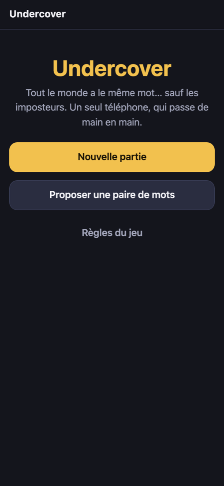
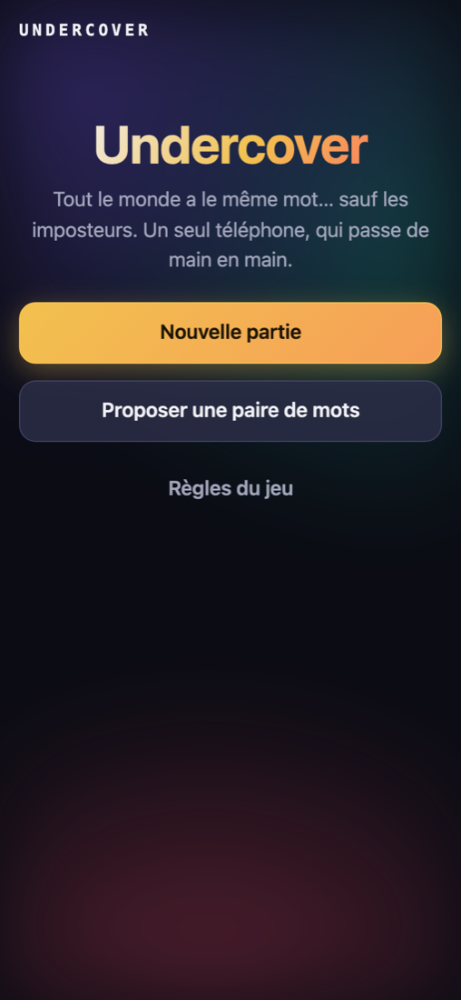
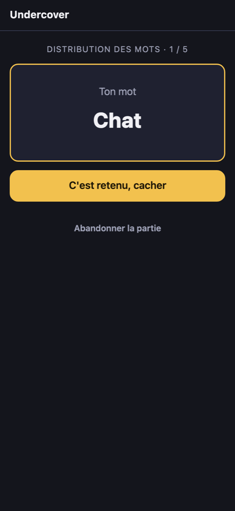
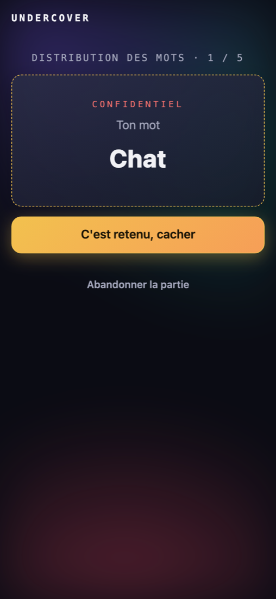
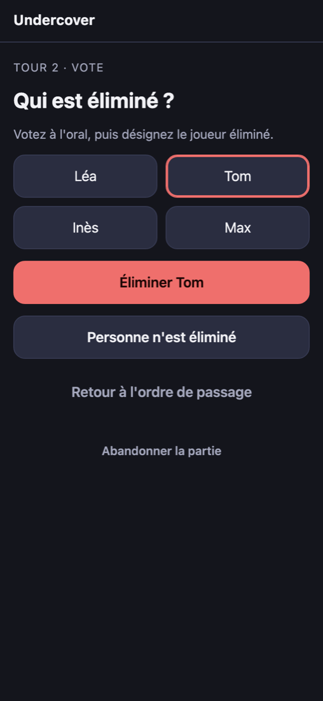
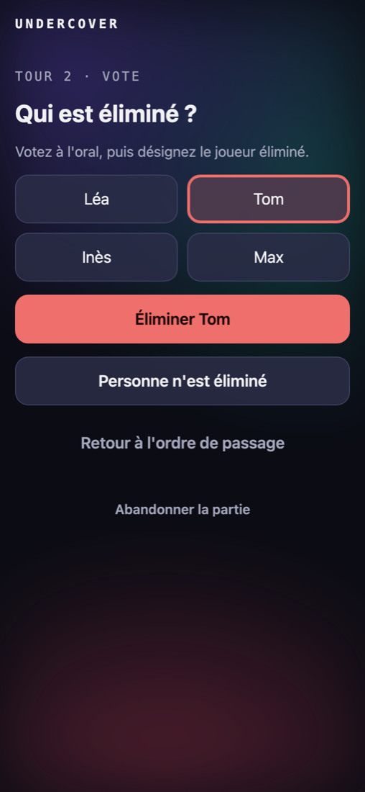
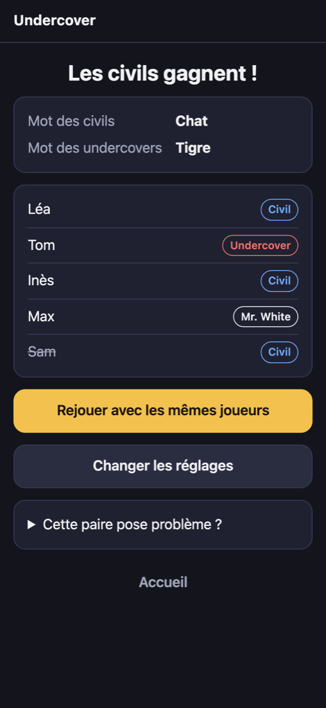
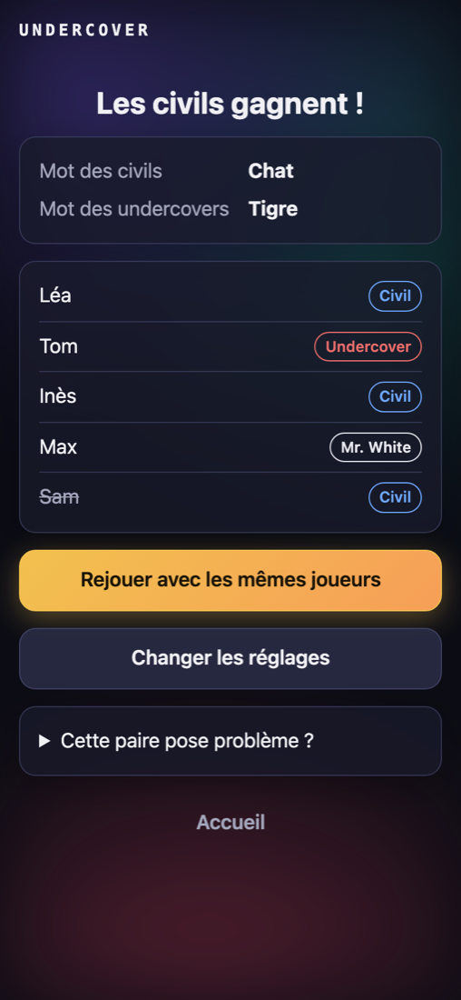

# Undercover — direction visuelle « Aurore de nuit »

> **Statut** : proposition, en attente de validation par Noah (ONBO-27).
> Ce document ne change aucun code applicatif. Les captures « proposition » ont été
> produites avec une feuille de style prototype (`undercover-visuel/proposition/prototype.css.diff`),
> appliquée temporairement sur l'interface actuelle puis retirée.

## 1. Existant

### Stack

- Front : **Preact 11 + TypeScript + Vite 8**, un seul fichier CSS écrit à la main
  (`web/src/styles.css`, 6,3 Ko), aucune bibliothèque d'UI, aucune police web, aucune image.
- Build actuel : JS 37,8 Ko (13,3 Ko gzip) + CSS 5,0 Ko (1,7 Ko gzip), embarqués dans le
  binaire Go.
- Thème : sombre par défaut, thème clair via `prefers-color-scheme`. Mobile-first, une colonne
  de 520 px maximum, boutons de 52 px de haut.
- Aucune animation ni transition aujourd'hui.

### Écrans

| # | Écran | Composant | Capture mobile |
|---|-------|-----------|----------------|
| 1 | Accueil | `HomePage` | `existant/mobile-01-accueil.png` |
| 2 | Réglages et prénoms (création de partie) | `SetupScreen` | `existant/mobile-02-reglages.png` |
| 3 | Distribution : « Passe le téléphone à … » puis mot secret | `DistributionScreen`, `SecretCard` | `existant/mobile-03-distribution.png`, `mobile-03b-mot.png` |
| 4 | Ordre de passage, revoir son mot | `RoundScreen` | `existant/mobile-04-ordre.png` |
| 5 | Vote (qui est éliminé ?) | `RoundScreen` | `existant/mobile-04b-vote.png` |
| 6 | Révélation du rôle éliminé | `RevealScreen` | `existant/mobile-05-reveal.png` |
| 7 | Mr. White devine le mot (+ résultat) | `GuessScreens` | non capturé (même gabarit que 3 et 6) |
| 8 | Fin de partie | `OverScreen` | `existant/mobile-06-fin.png` |
| 9 | Proposer une paire / Règles | `ProposePage`, `RulesPage` | `existant/mobile-07-proposer.png`, `mobile-08-regles.png` |

Il n'y a **pas de « lobby » ni de « rejoindre une partie »** : le jeu se joue sur un seul
téléphone (voir `apps/undercover/CLAUDE.md`). Les écrans 2 et 3 en tiennent lieu.
Captures desktop de l'existant : `existant/desktop-*.png`.

### Constat

Propre et lisible, mais neutre : fond plat `#14151c`, accent jaune, aucune ambiance.
Rien ne dit « espion », et le moment clé du jeu (découvrir son mot) est visuellement
identique à n'importe quelle carte. Sur desktop, la colonne de 520 px flotte au milieu
d'un grand vide.

## 2. Direction proposée : « Aurore de nuit »

Une soirée entre amis, une pièce sombre, un téléphone qui circule : l'écran est une
**pièce de théâtre d'ombres**. Fond nuit, lueurs d'aurore discrètes (clin d'œil à Pastebin),
et un vocabulaire « dossier confidentiel » pour le secret.

### Palette

| Rôle | Dark (défaut) | Light | Usage |
|------|---------------|-------|-------|
| Fond (`--bg`) | `#0b0c14` | `#f4f3fa` | Nuit presque noire |
| Surface (`--surface`) | `rgb(24 26 42 / 78%)` | `rgb(255 255 255 / 80%)` | Cartes, semi-transparentes : l'aurore transparaît |
| Accent (`--accent`) | `#f2c14e` | `#d99a12` | Actions principales, « lueur d'ambre » (inchangé : continuité) |
| Aurore A (`--glow-a`) | `#7c5cff` violet | idem | Coin haut gauche |
| Aurore B (`--glow-b`) | `#1fb8a6` turquoise | idem | Haut droite |
| Aurore C (`--glow-c`) | `#ff4d6d` rouge | idem | Bas : le danger rôde |
| Rôles | civil `#6fa8ff`, undercover `#ef6f6c`, Mr. White `#e9e9f0` | inchangés | Pastilles de rôle |

Les couleurs de rôle et de statut ne changent pas (le jeu les a apprises aux joueurs).
Les contrastes texte/fond restent ceux de l'existant ; à vérifier au ticket d'implémentation
pour les surfaces translucides (cible AA).

### Typographie

**Pile système uniquement**, aucune police web : zéro octet de plus, aucun appel externe,
compatible avec la CSP stricte.

- Titres et textes : `system-ui` (inchangé), titre d'accueil en **dégradé crème → ambre →
  rouge**.
- Accents « terminal d'espion » : `ui-monospace` en capitales espacées pour le nom de la
  marque (barre du haut), les surtitres (« DISTRIBUTION DES MOTS · 1 / 5 ») et le tampon
  « CONFIDENTIEL ».

### Ambiance et composants

- **Fond aurore** : trois halos flous (violet, turquoise, rouge) en `body::before`, fixes,
  qui dérivent lentement (22 s, `transform` seulement). Décoratif (`pointer-events: none`),
  **aucun effet lié au pointeur**.
- **Cartes** : surfaces translucides, ombre douce, sans `backdrop-filter` (coûteux sur
  téléphone d'entrée de gamme).
- **Bouton principal** : dégradé ambre → corail avec halo chaud ; retour tactile à
  l'appui (`scale(0.97)`).
- **Carte secret** : bordure en pointillés ambre, tampon rouge « CONFIDENTIEL », mot qui
  se révèle par un fondu net (flou → net, 0,6 s). C'est le moment fort du jeu.
- **Vote** : le joueur sélectionné prend une teinte rouge en plus du contour.

### Transitions et micro-interactions

| Où | Effet | Durée |
|----|-------|-------|
| Changement d'écran | Les blocs de l'écran apparaissent en cascade (monte de 10 px + fondu, décalage de 60 ms) | 450 ms |
| Ordre de passage | Les prénoms tombent un par un (100 ms d'écart) : l'ordre se « tire » sous les yeux | 400 ms |
| Mot secret | Flou → net | 600 ms |
| Boutons | Réduction à l'appui, transitions de couleur | 120–200 ms |
| Fond | Dérive des halos | 22 s, alternée |

**Accessibilité** : `prefers-reduced-motion: reduce` coupe toutes les animations et
transitions. Aucune information n'est portée par l'animation seule.

### Pistes écartées

- Thème « agent secret » très marqué (silhouettes, texture papier, police
  « machine à écrire ») : demande des images ou polices web, plus lourd, vieillit mal.
- Cartes « verre dépoli » (`backdrop-filter`) : joli mais coûteux en GPU sur mobile.
- Effets suivant le pointeur : exclus par le ticket (et inutiles sur un téléphone).
- Retournement 3D de carte pour le mot : possible plus tard, mais le fondu net suffit et
  évite un tour de cartes difficile à rendre accessible.

## 3. Maquettes

Captures de l'interface actuelle **avec le prototype CSS appliqué** (dossier
`undercover-visuel/proposition/`). La structure des écrans ne change pas.

| Écran | Avant | Après |
|-------|-------|-------|
| Accueil |  |  |
| Mot secret |  |  |
| Vote |  |  |
| Fin de partie |  |  |

Autres captures de la proposition : ordre de passage (`mobile-04-ordre.png`), réglages
(`mobile-02-reglages.png`), révélation (`mobile-05-reveal.png`), proposer une paire et
règles (`mobile-07-*`, `mobile-08-*`), **thème clair** (`mobile-01-accueil-clair.png`,
`mobile-06-fin-clair.png`) et **desktop** (`desktop-01-accueil.png`, `desktop-04b-vote.png`,
`desktop-06-fin.png`).

Les animations (cascade, dérive, fondu du mot) ne se voient pas sur des captures fixes :
elles sont décrites au §2 et se jugent en lançant le prototype (`make dev` après avoir
appliqué `proposition/prototype.css.diff` à `web/src/styles.css`).

## 4. Choix techniques

- **CSS seul, aucune dépendance ajoutée**, aucun changement de composant Preact : seules
  quelques classes existantes sont stylées autrement. Le prototype ajoute ~3,5 Ko de CSS
  (5,0 → 7,6 Ko, gzip 1,7 → 2,5 Ko) ; **JS inchangé** (13,3 Ko gzip).
- **Pas de bibliothèque d'animation** (Framer Motion, GSAP…) : `@keyframes` et `transition`
  suffisent.
- **Performances** : seules `transform` et `opacity` sont animées (composées par le GPU) ;
  le flou est statique sauf sur le mot secret, pendant 0,6 s. Si une mesure sur un vieux
  téléphone montre des saccades, on réduit le rayon du flou sur petit écran.
- **CSP** : aucune ressource externe, pas de style en ligne : compatible avec la CSP
  stricte.
- **Sécurité du jeu** : le tampon « CONFIDENTIEL » et le fondu ne changent pas la logique de
  masquage ; le mot reste affiché par `textContent` uniquement.
- **Tests** : le moteur et l'API ne sont pas touchés ; les tests Vitest actuels restent
  valables. À l'implémentation, ajouter une vérification manuelle mobile/desktop/clair/sombre
  et `prefers-reduced-motion`.
- **Desktop** : la colonne reste à 520 px ; l'aurore remplit le vide. Pas de mise en page
  deux colonnes : le jeu est conçu pour un téléphone.

## 5. Découpage proposé pour l'étape 2

1. Thème : variables, fond aurore, cartes, boutons, typographie (toutes les pages).
2. Écrans de jeu : carte secret, cascade, ordre de passage animé, vote.
3. Passe d'accessibilité : contrastes AA des surfaces translucides, `prefers-reduced-motion`,
   test sur un téléphone réel.

## 6. Questions pour Noah

- [ ] Garder l'ambre comme accent principal (proposé) ou passer à une couleur plus « espion »
      (turquoise) ?
- [ ] Le tampon « CONFIDENTIEL » te plaît-il, ou préfères-tu une carte plus sobre ?
- [ ] Thème clair : le garder (proposé, aurore atténuée) ou forcer le sombre, plus dans
      l'ambiance ?
