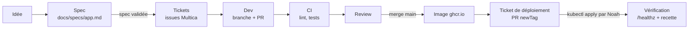

# Workflow de développement — spec → tickets → dev → CI → déploiement

Ce dossier décrit comment un projet de `zazi.cool` passe d'une idée à une version en
production, piloté dans **Multica** (issues, projets, agents). Les règles techniques
(stack, conventions, CI, déploiement) restent celles du [`CLAUDE.md` racine](../../CLAUDE.md) :
ce workflow les **orchestre**, il ne les remplace pas.

| Document | Contenu |
|----------|---------|
| [`modele-spec.md`](modele-spec.md) | Modèle de spec à copier pour chaque projet ou évolution |
| [`cycle-de-vie.md`](cycle-de-vie.md) | Statuts des tickets et critères de passage, dont le déploiement |
| [`organisation-multica.md`](organisation-multica.md) | Proposition de projets, agents et automatisations dans Multica |
| [`../specs/pastebin.md`](../specs/pastebin.md) | Spec pilote, rédigée avec le modèle |

> **Statut : proposition** (2026-10-16), en attente de validation. Rien n'est encore créé
> dans Multica.

---

## Vue d'ensemble

1. **Spec** : une issue de cadrage produit `docs/specs/<app>.md` (ou
   `docs/specs/<app>-<sujet>.md` pour une évolution), à partir du modèle. Elle est relue
   en PR et **validée par Noah** : c'est la seule porte d'entrée vers le développement.
2. **Tickets** : la section « Découpage » de la spec devient des sous-issues Multica de
   l'issue de cadrage, ordonnées par étapes (`--stage`).
3. **Dev** : un ticket = une branche courte (`feat/<app>-<sujet>`) = une PR liée à l'issue.
4. **CI** : le workflow GitHub Actions de l'app (lint → tests sur la PR ; image sur `main`).
5. **Review** puis **merge** par Noah.
6. **Déploiement** : ticket dédié qui bascule `newTag` dans `infra/apps/<app>/overlays/prod/`,
   appliqué par Noah (l'accès au cluster passe par son tunnel SSH), puis vérifié.

Le détail des statuts et des critères est dans [`cycle-de-vie.md`](cycle-de-vie.md).

---

## Inventaire du dépôt (2026-10-16)

### Projets

| Projet | Dossier | Sous-domaine | Statut | Contenu actuel |
|--------|---------|--------------|--------|----------------|
| Undercover | `apps/undercover/` | `undercover.zazi.cool` | **Production** depuis le 2026-10-14 (image `1601d93`) | Application complète |
| Pastebin | `apps/pastebin/` | `pb.zazi.cool` | Cadrage | `CLAUDE.md` seul (MVP envisagé, 4 décisions ouvertes) |
| Linktree | `apps/linktree/` | `link.zazi.cool` | Cadrage | `CLAUDE.md` seul (statique vs dynamique à trancher) |
| Accueil | `apps/home/` | `zazi.cool` (+ `www` → 301) | Cadrage | `CLAUDE.md` seul (page statique) |

### Stack

- **Commune** : back-end **Go 1.27** (bibliothèque standard, `net/http`), rendu serveur
  par défaut ; PostgreSQL partagé (une base par app) ; migrations maison embarquées.
- **Undercover** : Go + front **TypeScript / Preact / Vite** (Vitest, Prettier) embarqué
  dans le binaire ; PostgreSQL 18.6 ; contrat d'API Go ↔ TS vérifié par tests
  (`contract.json`). Image distroless non-root.
- **Pastebin** : Go, rendu serveur, PostgreSQL (prévu).
- **Linktree, Accueil** : Go, statique embarqué, sans base (prévu).

### CI (GitHub Actions)

- **Un seul workflow** : `.github/workflows/undercover.yml`, déclenché sur les chemins
  `apps/undercover/**` :
  - sur PR et `main` : `make lint` puis `make test` (PostgreSQL via Docker Compose) ;
  - sur `main` uniquement : build et push de `ghcr.io/zazi2004/undercover:<sha7>`.
- Les autres apps n'ont **pas encore de workflow** : il faudra en créer un par app
  (calqué sur celui d'Undercover) dans le premier ticket de chacune.

### Déploiement

- VPS OVHcloud (Ubuntu), **k3s mono-nœud**, Traefik, cert-manager (Let's Encrypt HTTP-01).
- Manifests **Kustomize** : `infra/apps/<app>/{base,overlays/prod}` ; secrets **SOPS + age**.
- Images publiques sur **ghcr.io**.
- **Déploiement manuel** : PR `chore(infra): deploy <app> <sha>` qui met à jour `newTag`,
  puis `kubectl apply -k` à travers le tunnel SSH (`infra/cluster/tunnel.sh`), puis
  `kubectl rollout status` et `curl /healthz`. Pas de GitOps pour l'instant.
- Infra partagée : PostgreSQL (`infra/data`, Job `create-databases`), sauvegardes
  `pg_dump` → Object Storage (CronJob 3 h, rétention 30 jours, Job de test de restauration).
- Monitoring : uptime externe prévu, **service pas encore choisi**.

### Constats utiles pour le workflow

- Le flux Undercover (PR #2 à #5) suit déjà le schéma visé : PR de fonctionnalité, merge,
  puis PR de déploiement séparée. Le workflow le formalise plutôt que de le changer.
- Le déploiement exige le tunnel SSH et la clé age de Noah : **un agent ne peut pas
  déployer seul**, et le `CLAUDE.md` racine (§10) lui demande de toute façon de demander
  avant toute action sur la production. L'étape reste donc humaine, avec une vérification
  externe automatisable (voir [`cycle-de-vie.md`](cycle-de-vie.md#déploiement)).
- Quelques branches déjà mergées traînent sur `origin` (`feat/undercover-mvp`,
  `chore/infra-*`, `feat/undercover-extreme-only`) : activer la suppression automatique
  des branches après merge éviterait l'accumulation.
