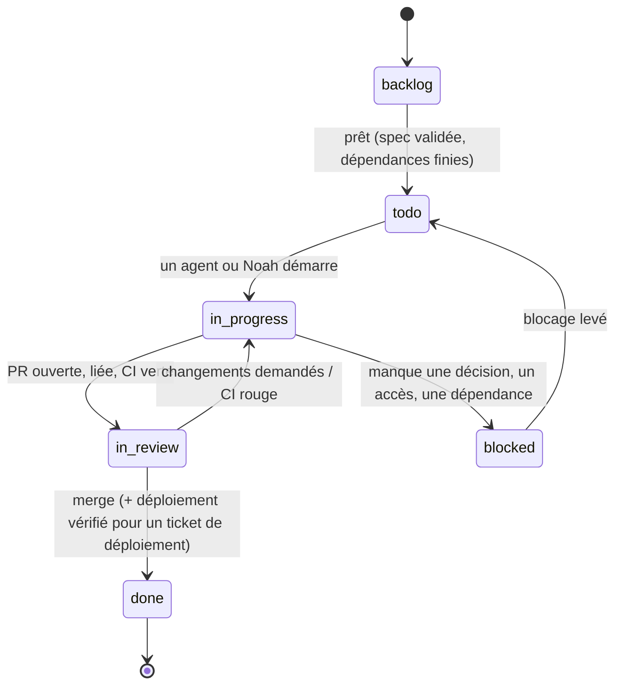

# Cycle de vie des tickets dans Multica

Un **ticket** est une issue Multica. Il y en a trois sortes, qui suivent les mêmes statuts
mais avec des critères de sortie différents :

| Sorte | Exemple de titre | Produit |
|-------|------------------|---------|
| **Cadrage** | `Spec pastebin` | `docs/specs/<app>.md` validée + sous-issues créées |
| **Dev / infra** | `Pastebin : création et lecture d'un paste` | Une PR mergée sur `main` |
| **Déploiement** | `Déployer pastebin <sha7>` | La version en production, vérifiée |

Les tickets de dev et de déploiement sont des **sous-issues** de l'issue de cadrage,
regroupés par étapes (`stage`) dans l'ordre du découpage de la spec.

---

## Statuts



`cancelled` reste disponible à tout moment (abandon, ou doublon avec `--duplicate-of`).

| Statut | Sens | Qui le pose |
|--------|------|-------------|
| `backlog` | Le ticket existe mais ne doit **pas** démarrer. Pour un ticket assigné à un agent, aucun run ne part. | Rédacteur de la spec, à la création des sous-issues |
| `todo` | Prêt à être pris. Pour un ticket assigné à un agent, **le passage en `todo` lance le run**. | Noah, ou automatiquement quand l'étape précédente est finie |
| `in_progress` | Travail en cours (branche ouverte, PR en brouillon possible). | L'agent ou Noah au démarrage |
| `in_review` | Livrable prêt, en attente de relecture et de merge par Noah. | L'agent qui livre |
| `blocked` | Impossible d'avancer sans quelque chose d'extérieur. Un commentaire dit **quoi** et **qui**. | Celui qui est bloqué |
| `done` | Terminé et accepté. **Toujours posé par Noah** (les agents s'arrêtent à `in_review`). | Noah |

---

## Critères de passage

### Commun à tous les tickets

| Passage | Critères |
|---------|----------|
| `backlog → todo` | La spec du projet est **validée** ; les tickets dont celui-ci dépend sont `done` ; aucune décision ouverte de la spec ne le bloque ; il a un assigné. |
| `todo → in_progress` | Le ticket est relu (titre, exigences citées, critères d'acceptation repris de la spec). |
| `* → blocked` | Commentaire qui nomme le manque (décision, accès, dépendance) et la personne qui peut le lever. |
| `blocked → todo` | Le manque est comblé ; le commentaire de déblocage le dit. |

### Ticket de cadrage

| Passage | Critères |
|---------|----------|
| `in_progress → in_review` | PR ouverte avec `docs/specs/<app>.md` rempli selon le [modèle](modele-spec.md) ; chaque exigence a au moins un critère d'acceptation ; chaque décision ouverte a une proposition ; le découpage liste les tickets jusqu'au déploiement. |
| `in_review → done` | Noah a validé la spec (merge de la PR, champ « Statut » passé à « Validée le … ») ; les sous-issues du découpage sont créées en `backlog` et la première étape est passée en `todo`. |

### Ticket de dev / infra

| Passage | Critères |
|---------|----------|
| `todo → in_progress` | Branche créée : `feat/<app>-<sujet>`, `fix/<app>-<sujet>` ou `chore/…`. |
| `in_progress → in_review` | **PR ouverte et liée à l'issue** (clé `<CLÉ>-<n>` dans le titre de la PR, voir ci-dessous) ; `make lint` et `make test` passent en local, résultat rapporté dans le commentaire ; **CI verte** sur la PR ; critères d'acceptation du ticket couverts par des tests ou démontrés ; `CLAUDE.md` de l'app mis à jour si une règle a changé. |
| `in_review → in_progress` | Review avec changements demandés, ou CI devenue rouge. |
| `in_review → done` | **Review faite et PR mergée** sur `main` par Noah ; pour une PR qui touche `apps/<app>/**`, le job « Build and push image » de `main` a publié `ghcr.io/zazi2004/<app>:<sha7>`. |

**Lier la PR à l'issue** : Multica relie une PR à une issue quand la clé de l'issue
(`<CLÉ>-<n>`, par exemple `ONBO-12`) figure dans le **titre** de la PR ou dans le **nom de
branche**, ou juste après `Closes` / `Fixes` dans la description. Une simple mention dans
la description ne suffit pas. Convention retenue, compatible avec les Conventional Commits :

```text
Titre de PR : feat(pastebin): create and read pastes (ONBO-12)
Branche     : feat/pastebin-create-read
```

L'état réel de la PR (ouverte, mergée, CI) se lit dans Multica avec
`multica issue pull-requests <issue-id>`, et non en devinant depuis GitHub.

### Ticket de déploiement

Voir la section suivante.

---

## Déploiement

**Objectif (décidé le 2026-10-16) : un déploiement 100 % automatisé à terme.** Un merge
sur `main` avec une CI verte doit suffire à mettre la version en production, à la vérifier
de l'extérieur et à revenir en arrière tout seul si la vérification échoue. On y va par
étapes ; l'**étape 3 (GitOps) est atteinte pour pastebin** : Flux déploie, et le job `verify`
se lance tout seul après le merge du bump (`.github/workflows/deploy-verify.yml`). Les apps
pas encore migrées vers Flux (undercover) restent à l'étape 2.

### Contraintes à respecter

- **Aucun agent n'a accès au cluster** (`CLAUDE.md` racine §10) : les agents ne touchent
  qu'au dépôt Git. Le **merge sur `main` par Noah reste la porte** ; c'est lui qui, à la
  cible, déclenche le déploiement.
- **L'API Kubernetes (6443) n'est pas exposée** : seul le tunnel SSH de Noah y accède
  aujourd'hui.
- **Secrets SOPS + age** : Kustomize ne déchiffre pas. Tout déploiement automatique doit
  disposer d'une clé age capable de déchiffrer les `*.enc.yaml` de l'app.
- **VPS de 4 Go** partagé : l'outillage ajouté doit rester léger.
- L'infrastructure partagée (`infra/cluster`, `infra/data`) **reste appliquée à la main**
  à toutes les étapes : un échec y touche toutes les apps.

### Options comparées

| | **GitOps pull** (Flux ou Argo CD dans le cluster) | **Push depuis GitHub Actions** (`kubectl apply -k` dans la CI) |
|---|---|---|
| Accès au cluster | Le cluster **tire** le dépôt (clé de déploiement GitHub en lecture seule) : rien à ouvrir, 6443 reste fermé | La CI doit **joindre l'API** : ouvrir 6443, ou une clé SSH + tunnel depuis le runner, ou un VPN (Tailscale…) |
| Identifiants hors du VPS | Aucun accès au cluster stocké dans GitHub | Un kubeconfig (admin ou compte de service) et une clé SSH stockés dans les secrets GitHub |
| Secrets SOPS | Flux déchiffre nativement SOPS + age (clé age dans un `Secret` du cluster) ; Argo CD demande un plugin | Clé age dans les secrets GitHub, `sops decrypt` dans le job |
| Dérive | Réconciliation continue : une modification manuelle est corrigée, l'état du cluster = `main` | Appliqué seulement au moment du job ; la dérive n'est pas vue |
| Rollback | `git revert` du changement de tag → réconcilié automatiquement | Relancer le job avec l'ancien tag, ou `git revert` + nouveau job |
| Coût | Flux : ~4 contrôleurs, de l'ordre de 150–300 Mio ; Argo CD plus lourd (UI, Redis, repo-server) | Rien sur le VPS |
| Mise en place | Bootstrap une fois par Noah, puis tout est dans le dépôt | Simple au départ, mais élargit la surface d'attaque (identifiants du cluster dans la CI) |

**Recommandation : GitOps pull avec Flux.** Il garde l'API fermée et aucun identifiant du
cluster dans GitHub, il gère SOPS sans plugin, et il est nettement plus léger qu'Argo CD
sur un VPS de 4 Go. La contrepartie est une **clé age dédiée au cluster**, stockée dans un
`Secret` du namespace `flux-system` : la règle actuelle « clé age hors du VPS » est donc
assouplie pour cette clé uniquement. La clé personnelle de Noah reste hors du VPS ; la clé
du cluster est un second destinataire dans `.sops.yaml` (`sops updatekeys`), révocable
seule. À valider avant l'étape 3.

### Trajectoire

| Étape | Déclenchement | Vérification | Rollback | Qui agit |
|-------|---------------|--------------|----------|----------|
| **1. Manuel** (actuel) | PR `newTag` préparée par un agent ; `kubectl apply -k` par Noah via le tunnel | `curl` externe (`/healthz`, `/readyz`, TLS) par un agent ou Noah | Remettre l'ancien `newTag` et réappliquer, à la main | Agent prépare, Noah merge et applique |
| **2. Outillé** | Idem, mais **la CI ouvre elle-même la PR `newTag`** après le push de l'image sur `main` | **Job CI `verify`** (déclenché à la main ou après le merge de la PR `newTag`) : attend que `GET /version` renvoie le SHA attendu, puis vérifie `/healthz`, `/readyz`, la redirection HTTP → HTTPS et le certificat | Manuel | Noah merge la PR de bump et applique |
| **3. GitOps** (atteinte pour pastebin) | **Flux** réconcilie `infra/apps/<app>/overlays/prod` depuis `main` : **merger la PR `newTag` = déployer** | Job `verify` lancé automatiquement après le merge (workflow `deploy-verify`, qui déduit l'app, le SHA et l'URL du diff et enregistre le déploiement dans l'environnement GitHub `production`) ; Flux signale aussi un rollout en échec (`wait`, `healthChecks`, `timeout`) | `git revert` de la PR `newTag` (Flux réapplique l'ancienne version) | Noah merge ; plus aucun `kubectl` pour une app |
| **4. Automatique** (cible) | La CI, une fois l'image poussée, **met à jour `newTag` sur `main`** (PR de bump en auto-merge quand ses checks sont verts) | Job `verify` automatique | **Automatique** : si `verify` échoue, la CI revert le bump ; Flux remet l'ancienne version ; la tâche Multica passe en `blocked` | Personne : le merge de la PR de fonctionnalité par Noah suffit |

Prérequis par étape :

- **Étape 2** : endpoint `GET /version` dans chaque app (SHA injecté au build :
  `-ldflags "-X main.version=…"` via un `--build-arg` du Dockerfile), job `verify`
  réutilisable dans la CI, autorisation pour GitHub Actions de créer des PR.
- **Étape 3** : bootstrap Flux par Noah (Flux sur `main`, chemins `infra/apps/*/overlays/prod`
  uniquement), clé age du cluster, clé de déploiement GitHub en lecture seule. Le premier
  déploiement d'une app (namespace, secret SOPS) passe alors aussi par Flux ; seule sa base
  (`infra/data`) reste manuelle.
- **Étape 4** : auto-merge de la PR de bump (ou commit direct par la CI, si la protection
  de `main` l'autorise), revert automatique, notification vers Multica (un autopilot
  déclenché par webhook depuis le job `verify`, voir
  [`organisation-multica.md`](organisation-multica.md#automatisations)).

Un mauvais déploiement est déjà en partie protégé à toutes les étapes : avec les
`readinessProbe` et le rolling update, les pods de la nouvelle version ne reçoivent pas de
trafic tant qu'ils ne sont pas prêts, et l'ancienne version reste en service. Le rollback
traite les cas que les sondes ne voient pas (version qui démarre mais se comporte mal,
recette en échec).

### Ticket « Déployer <app> <sha7> »

Le déploiement reste un **ticket à part entière**, dernier de chaque étape livrable du
découpage, parce qu'il se fait après le merge, avec un autre SHA que celui de la PR de
fonctionnalité, et qu'il regroupe souvent plusieurs tickets. Sous-issue de l'issue de
cadrage, il reprend la section « Recette après déploiement » de la spec. Son rôle change
avec la trajectoire :

| Étape | Contenu du ticket | Critères pour `in_review` | Critères pour `done` |
|-------|-------------------|---------------------------|----------------------|
| 1 | Un agent prépare la PR `chore(infra): deploy <app> <sha7> (<CLÉ>-<n>)` et liste les commandes | PR ouverte, image `ghcr.io/zazi2004/<app>:<sha7>` publiée (job CI de `main` vert) | PR mergée, `kubectl apply -k` et `rollout status` réussis par Noah, vérification externe et recette cochées en commentaire |
| 2 | L'agent relie la PR de bump ouverte par la CI et vérifie son contenu | Idem | PR mergée, appliquée par Noah, **job `verify` vert** pour ce SHA, recette cochée |
| 3 | Idem ; plus de commande à lancer. Le ticket est créé à partir du gabarit ci-dessous | PR de bump liée, CI verte | PR mergée, **Flux a réconcilié** et **job `verify` vert** (run `deploy-verify` du merge, déploiement `production` en `success`), recette cochée |
| 4 | Le ticket n'est plus créé à la main : un autopilot l'ouvre à partir du résultat de `verify`, comme **trace** du déploiement | — | Job `verify` vert pour ce SHA ; la recette manuelle de la spec n'est demandée qu'au **premier** déploiement d'une app |

À toutes les étapes, si la vérification échoue : rollback (manuel aux étapes 1 à 3,
automatique à l'étape 4), ticket → `blocked` avec le constat, et ticket `fix/…`.
`done` reste posé par Noah aux étapes 1 à 3 ; à l'étape 4, la clôture automatique du
ticket de trace quand `verify` est vert est à confirmer au moment de la mettre en place.

#### Gabarit (étape 3)

```markdown
Titre : Déployer <app> <sha7>

## À faire
- Relier la PR de bump `chore(infra): deploy <app> <sha7>` (clé du ticket dans le titre).
- Après le merge par Noah, lire le résultat du run `deploy-verify` (onglet Actions, ou
  Deployments → `production`) : `verify` vert pour <sha7>. Aucune commande à lancer.
- Cocher la recette de la spec (« Recette après déploiement »).

## Critères d'acceptation
- `/version` renvoie <sha7>, `/healthz`, `/readyz`, HTTPS et TLS vérifiés par `verify`.
- Si `verify` est rouge : `git revert` de la PR de bump (Flux réapplique l'ancienne
  version), ticket `blocked` avec le constat.
```

### Ce qui reste interdit aux agents

Conformément au `CLAUDE.md` racine (§10) : aucun `kubectl` contre le cluster, aucune
migration en production, aucune modification de `infra/cluster` ou `infra/data` sans
accord explicite, aucun secret en clair. Un agent qui a besoin de l'une de ces actions
passe le ticket en `blocked` et le dit. Aux étapes 3 et 4, un agent peut **préparer**
une PR qui déclenche un déploiement, mais seul le merge par Noah (ou le bump automatique
de la CI, issu d'un merge de Noah) le déclenche.
