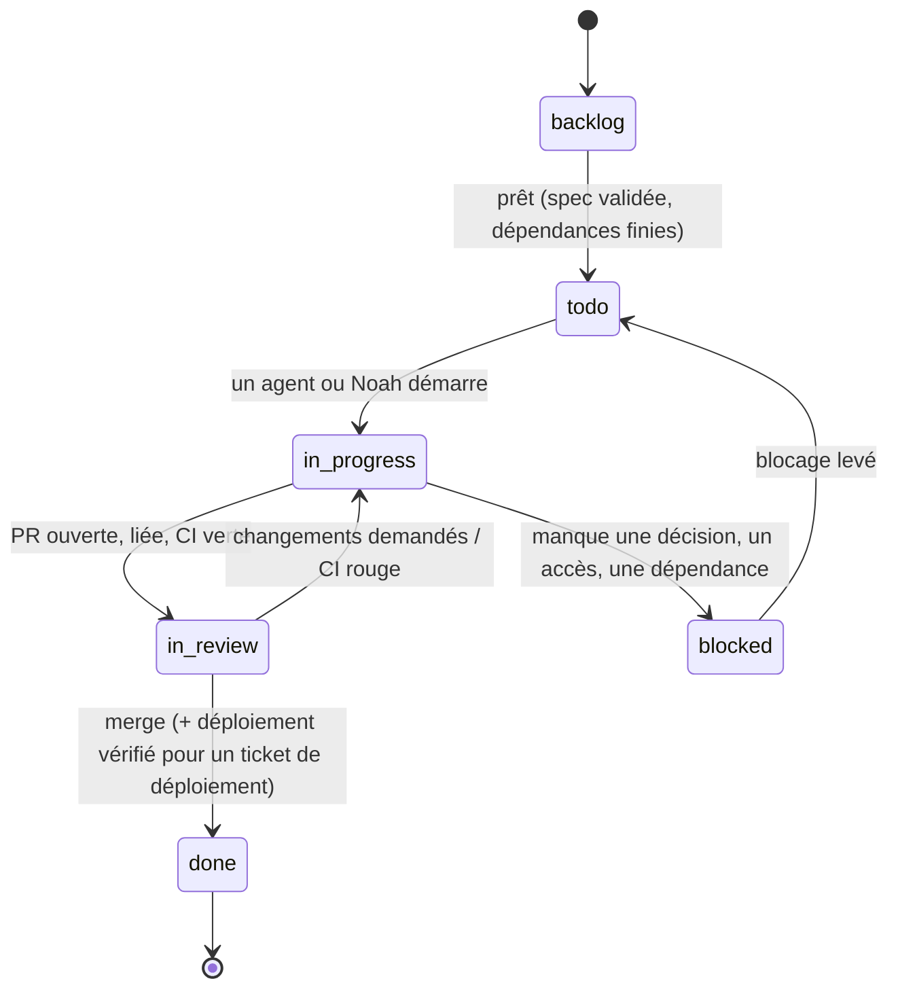

# Cycle de vie des tickets dans Multica

Un **ticket** est une issue Multica. Il y en a trois sortes, qui suivent les mêmes statuts
mais avec des critères de sortie différents :

| Sorte | Exemple de titre | Produit |
|-------|------------------|---------|
| **Cadrage** | `Spec pastebin` | `docs/specs/<app>.md` validée + sous-issues créées |
| **Dev / infra** | `Pastebin : création et lecture d'un paste` | Une PR mergée sur `main` |
| **Déploiement** | `Déployer pastebin <sha7>` | La version en production, vérifiée |

Les tickets de dev et de déploiement sont des **sous-issues** de l'issue de cadrage,
regroupés par étapes (`stage`) dans l'ordre du découpage de la spec.

---

## Statuts



`cancelled` reste disponible à tout moment (abandon, ou doublon avec `--duplicate-of`).

| Statut | Sens | Qui le pose |
|--------|------|-------------|
| `backlog` | Le ticket existe mais ne doit **pas** démarrer. Pour un ticket assigné à un agent, aucun run ne part. | Rédacteur de la spec, à la création des sous-issues |
| `todo` | Prêt à être pris. Pour un ticket assigné à un agent, **le passage en `todo` lance le run**. | Noah, ou automatiquement quand l'étape précédente est finie |
| `in_progress` | Travail en cours (branche ouverte, PR en brouillon possible). | L'agent ou Noah au démarrage |
| `in_review` | Livrable prêt, en attente de relecture et de merge par Noah. | L'agent qui livre |
| `blocked` | Impossible d'avancer sans quelque chose d'extérieur. Un commentaire dit **quoi** et **qui**. | Celui qui est bloqué |
| `done` | Terminé et accepté. **Toujours posé par Noah** (les agents s'arrêtent à `in_review`). | Noah |

---

## Critères de passage

### Commun à tous les tickets

| Passage | Critères |
|---------|----------|
| `backlog → todo` | La spec du projet est **validée** ; les tickets dont celui-ci dépend sont `done` ; aucune décision ouverte de la spec ne le bloque ; il a un assigné. |
| `todo → in_progress` | Le ticket est relu (titre, exigences citées, critères d'acceptation repris de la spec). |
| `* → blocked` | Commentaire qui nomme le manque (décision, accès, dépendance) et la personne qui peut le lever. |
| `blocked → todo` | Le manque est comblé ; le commentaire de déblocage le dit. |

### Ticket de cadrage

| Passage | Critères |
|---------|----------|
| `in_progress → in_review` | PR ouverte avec `docs/specs/<app>.md` rempli selon le [modèle](modele-spec.md) ; chaque exigence a au moins un critère d'acceptation ; chaque décision ouverte a une proposition ; le découpage liste les tickets jusqu'au déploiement. |
| `in_review → done` | Noah a validé la spec (merge de la PR, champ « Statut » passé à « Validée le … ») ; les sous-issues du découpage sont créées en `backlog` et la première étape est passée en `todo`. |

### Ticket de dev / infra

| Passage | Critères |
|---------|----------|
| `todo → in_progress` | Branche créée : `feat/<app>-<sujet>`, `fix/<app>-<sujet>` ou `chore/…`. |
| `in_progress → in_review` | **PR ouverte et liée à l'issue** (clé `<CLÉ>-<n>` dans le titre de la PR, voir ci-dessous) ; `make lint` et `make test` passent en local, résultat rapporté dans le commentaire ; **CI verte** sur la PR ; critères d'acceptation du ticket couverts par des tests ou démontrés ; `CLAUDE.md` de l'app mis à jour si une règle a changé. |
| `in_review → in_progress` | Review avec changements demandés, ou CI devenue rouge. |
| `in_review → done` | **Review faite et PR mergée** sur `main` par Noah ; pour une PR qui touche `apps/<app>/**`, le job « Build and push image » de `main` a publié `ghcr.io/zazi2004/<app>:<sha7>`. |

**Lier la PR à l'issue** : Multica relie une PR à une issue quand la clé de l'issue
(`<CLÉ>-<n>`, par exemple `ONBO-12`) figure dans le **titre** de la PR ou dans le **nom de
branche**, ou juste après `Closes` / `Fixes` dans la description. Une simple mention dans
la description ne suffit pas. Convention retenue, compatible avec les Conventional Commits :

```text
Titre de PR : feat(pastebin): create and read pastes (ONBO-12)
Branche     : feat/pastebin-create-read
```

L'état réel de la PR (ouverte, mergée, CI) se lit dans Multica avec
`multica issue pull-requests <issue-id>`, et non en devinant depuis GitHub.

### Ticket de déploiement

Voir la section suivante.

---

## Déploiement

### Représentation

Le déploiement est un **ticket à part entière**, dernier de chaque étape livrable du
découpage (et pas un simple statut d'un ticket de dev), pour trois raisons :

- il se fait **après** le merge, avec un autre SHA que celui de la PR de fonctionnalité ;
- il regroupe souvent plusieurs tickets mergés en une seule mise en production ;
- il demande l'accès de Noah au cluster (tunnel SSH, clé age), qu'aucun agent n'a.

Titre : `Déployer <app> <sha7>` ; sous-issue de l'issue de cadrage ; dépend des tickets
de dev de son étape. Il reprend la section « Recette après déploiement » de la spec.

### Déroulé et critères

| Étape | Qui | Critère de sortie |
|-------|-----|-------------------|
| 1. Préparer | Agent | PR `chore(infra): deploy <app> <sha7> (<CLÉ>-<n>)` qui met à jour `newTag` dans `infra/apps/<app>/overlays/prod/kustomization.yaml` ; l'image `ghcr.io/zazi2004/<app>:<sha7>` existe (job CI de `main` vert) ; le commentaire liste les commandes à lancer et la recette. Ticket → `in_review`. |
| 2. Appliquer | Noah | PR mergée ; `kubectl apply -k infra/apps/<app>/overlays/prod` puis `kubectl -n <app> rollout status deployment/<app>` réussi. Premier déploiement d'une app : namespace, secret SOPS et base (`infra/data`) appliqués avant (voir `infra/README.md`). |
| 3. Vérifier | Agent (re-sollicité par un commentaire de Noah) ou Noah | `curl -sI https://<sous-domaine>.zazi.cool/healthz` → `200` ; `/readyz` → `200` ; certificat TLS valide ; recette de la spec cochée dans un commentaire. |
| 4. Clore | Noah | Ticket → `done`. Si la recette échoue : remettre l'ancien `newTag`, réappliquer, ticket → `blocked` avec le constat, et ouvrir un ticket `fix/…`. |

La vérification de l'étape 3 ne demande **aucun accès au cluster** : elle se fait depuis
l'extérieur, comme le ferait le futur service d'uptime. Elle confirme que l'app répond,
mais pas **quelle version** tourne. Pour le prouver sans `kubectl`, une évolution
possible est un endpoint `GET /version` (ou un en-tête) renvoyant le SHA de build — à
décider (voir [`organisation-multica.md`](organisation-multica.md#décisions-demandées)).

### Ce qui reste interdit aux agents

Conformément au `CLAUDE.md` racine (§10) : aucun `kubectl` contre le cluster, aucune
migration en production, aucune modification de `infra/cluster` ou `infra/data` sans
accord explicite, aucun secret en clair. Un agent qui a besoin de l'une de ces actions
passe le ticket en `blocked` et le dit.
